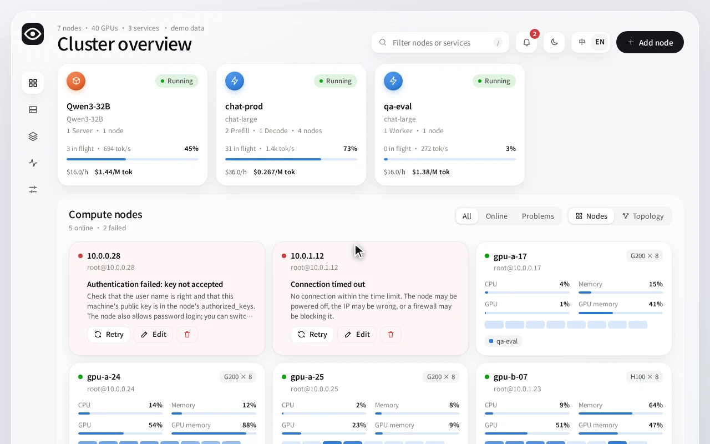
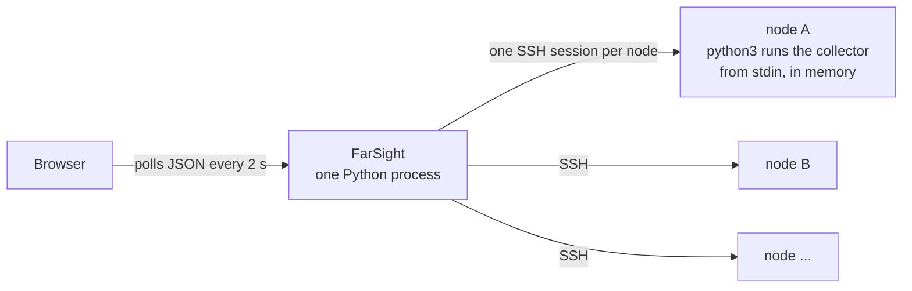

<div align="center">


# FarSight

**See your whole LLM inference fleet over SSH. Nothing to install on the nodes.**

FarSight is an agentless web dashboard for [Dynamo](https://github.com/ai-dynamo/dynamo) and
[SGLang](https://github.com/sgl-project/sglang) inference clusters.<br>
Give it a node's IP address: it shows the node's CPU, memory and GPUs, finds the inference services running across
your nodes, draws how the servers talk to each other, and tells you what a million tokens cost.


[Quick start](#quick-start) · [Features](#features) · [How it works](#how-it-works) ·
[What it does on your nodes](#what-farsight-does-on-your-nodes) · [Reference](#reference)



<sub>A 45-second tour, recorded on the synthetic cluster of <code>farsight --demo</code>. Also available as an <a href="docs/tour.mp4">MP4 video</a>.</sub>

</div>

## Why FarSight

- **Nothing to deploy.** No agent, no exporter, no Prometheus, no Grafana. FarSight logs in over SSH, pipes a small
  read-only collector into `python3` on the node, and the collector exits the moment the connection closes.
- **Organized by service, not by machine.** A frontend, its prefill and decode workers and their etcd are shown as
  one service, across all the nodes it spans, with its request path, health, throughput, latency and GPUs.
- **Safe on production nodes.** The collector reads `/proc`, `nvidia-smi`, `docker` and the kernel's socket table.
  It never scans ports and only talks to HTTP ports a service declares itself.
- **Zero dependencies.** The Python standard library and the system `ssh`. The frontend is plain ES modules:
  no build step, no CDN, works on an air-gapped network.

## Quick start

You need Python 3.8+ and the OpenSSH client on the machine that runs FarSight, and `python3` on the nodes you want
to watch.

```bash
git clone https://github.com/KellyGong/FarSight.git
cd FarSight
pip install .
```

This installs the `farsight` command. If your shell does not find it, use `python3 -m farsight` instead.

**1. Look around with synthetic data** (no SSH involved, nothing is saved):

```bash
farsight --demo
```

Open <http://127.0.0.1:8790/>.

**2. Watch your own nodes:**

```bash
farsight
```

Open <http://127.0.0.1:8790/>, click **Add node**, enter one or more hosts and choose how to log in:

| Login | What it uses |
|---|---|
| **Key / agent** (default) | Exactly what `ssh` in your terminal uses: `~/.ssh/config`, ssh-agent, ProxyJump and your default keys. A specific private key file can be given. |
| **Password** | Kept in the memory of the FarSight process only; asked again after a restart. |
| **This machine** | Watches the machine FarSight runs on, without SSH. |

Several hosts can be added at once, separated by spaces, commas or newlines: `10.0.0.24`, `10.0.0.[1-8]`,
`10.0.0.[1,3,5]`, `root@gpu-a:2222`. Each node's card appears at once and fills in when the connection is up. If it
cannot connect, the card says why and what to do. Services found on the nodes show up on top by themselves.

<details>
<summary><b>Other ways to run it</b></summary>

```bash
python3 -m farsight                 # from the clone, without installing anything
pip install git+https://github.com/KellyGong/FarSight.git     # install without cloning
```

FarSight runs in the foreground. Use `tmux`, `screen` or a systemd unit to keep it running.

FarSight is not on PyPI: `pip install farsight` installs an unrelated package. To remove FarSight, run
`pip uninstall farsight-dashboard`.

</details>

### Open it from your laptop

Run FarSight on a machine that can SSH to the nodes, for example a login node. It listens on `127.0.0.1` by default,
so forward the port from your laptop and open <http://localhost:8790/>:

```bash
ssh -N -L 8790:127.0.0.1:8790 you@farsight-host
```

To serve other machines directly, start it with `farsight --host 0.0.0.0`. It then prints a URL that carries an
access token; open that URL once and the browser remembers it.

<details>
<summary><b>Through a jump host</b></summary>

When your laptop can only reach a jump host, and the jump host can reach the machine FarSight runs on, start
FarSight with `--host 0.0.0.0` and forward through the jump host:

```bash
ssh -N -L 8790:<farsight-host-ip>:8790 you@jump-host
```

Then open `http://localhost:8790/?token=<token>`. If port 8790 is taken on your laptop, change the first `8790` in
the command and the port in the URL.

</details>

## Features

### Nodes and GPUs

CPU (per core), memory with shared memory shown separately, disks, network, and every GPU's utilization, memory,
temperature and power. Each GPU says which service, container or user occupies it. About an hour of history is kept
for the trend charts.

### Services

Dynamo and SGLang processes are discovered automatically and grouped into services. A service page shows the request
path (frontend, prefill, decode, service discovery), which node and GPUs every component uses, requests in flight
and queued, output tokens per second, time to first token P50 / P95, inter-token latency, error ratio, cache hits
and KV pool usage, read from the service's own `/metrics`.

### Communication topology

The **Topology** tab of the overview draws one box per server and one line per pair of servers that talk to each
other, labeled with the protocols in use. Click a label for the channels behind it (direction, port, number of
connections, evidence). Click a server to look inside: its components, their processes and GPUs, and the channels
between them.

The lines are real connections taken from each node's socket table, not a diagram drawn from configuration.

### Cost per million tokens

Enter what a GPU costs you per hour, per GPU model, under **Settings → Cost estimate**. FarSight divides the rent of
the GPUs a service occupies by its measured throughput and shows the cost of a million tokens: input on a cache
miss, input on a cache hit, output, and blended, over the last 1, 5, 15 or 60 minutes.

### Alerts and activity

Node lost, service degraded, GPU too hot, GPU spinning at 100% with no process, `/dev/shm` almost full, high error
ratio, slow first token. A condition has to hold for a while before it is raised, and its recovery is recorded.

### Light and dark, English and 中文

Both switches are at the top right. The language follows the browser by default; messages produced by the server
(connection failures, alerts, activity) are translated too.

## How it works



- For each node FarSight keeps one long-lived `ssh` session. The collector (`farsight/collector.py`, a single file
  that needs only the standard library of Python 3.6+) is sent over stdin and runs in memory. Nothing is written to
  the node, and when the SSH session ends the collector exits.
- **Every 2 seconds** it reports CPU, memory and per-GPU load (`/proc`, `nvidia-smi`).
- **Every 10 seconds** it reports which processes hold which GPUs, the Dynamo / SGLang processes and their
  containers, the services' `/health` and `/metrics`, and the TCP sockets those processes hold.
- FarSight joins the reports of all nodes into services, keeps about an hour of samples in memory, evaluates the
  alerts and serves the page.

You can run the collector by hand on a node to see exactly what it reports:
`python3 farsight/collector.py --once`.

## What FarSight does on your nodes

The collector only reads. It reads `/proc`, runs `nvidia-smi`, `docker ps`, `docker inspect` and `ss`, and sends
HTTP `GET` requests to the endpoints listed below. It writes no file, sends no signal and changes no setting.

- **Container environment**: only an allowlist of variables is read (`DYN_*`, `ETCD_ENDPOINTS` and a few others
  that tell which service a component belongs to and how it communicates). Nothing else leaves the node.
- **Worker config files**: when a worker is started with `--config <file>`, about a dozen keys are read from that
  file (ports, disaggregation mode, transfer backend, TP / DP size). Model paths, keys and everything else are
  neither read nor sent.
- **Privileges**: logging in as root gives the most complete picture. A normal user works too; what cannot be read
  is shown as unknown.

### It never scans ports

The collector sends HTTP only to ports **a service declares as HTTP itself**:

| Component | Where the port comes from | Paths requested |
|---|---|---|
| Dynamo frontend | `--http-port` (or `DYN_HTTP_PORT`) | `/health`, `/metrics` |
| Dynamo worker | `DYN_SYSTEM_PORT` | `/metrics`; `/health` only once the worker is ready |
| Native SGLang server | `--port` | `/metrics`; `/v1/models` when metrics are off, at most once a minute |
| etcd | `--listen-client-urls` | `/health` |

This is a hard rule, not an optimization. HTTP sent to an inference engine's ZeroMQ port or to a NIXL listener can
make real requests fail or crash the listening thread. Therefore:

- the `--port` of `dynamo.sglang` is not an HTTP server and is never contacted;
- ports 17000, 17100, 19000 and 19100 are never contacted (adjustable with the collector's `--skip-ports`);
- before the first request to a port, the collector connects without sending anything; if the other side speaks
  first (ZeroMQ, SSH and the like), no HTTP is ever sent to that port;
- a worker that is still loading answers `/health` with 503 and logs an error, so `/health` is not requested while
  it loads, and at most once a minute while it is not ready;
- the `/health` of a native SGLang server can run a real generation in some versions, so it is not used.

A worker without `DYN_SYSTEM_PORT` is shown as "not probed", with process and GPU information only.

The topology is read from the socket table (`ss -tnp`), which is kernel data: nothing is sent to any port to
build it.

## Reference

### Command line

```
farsight [--host 127.0.0.1] [--port 8790] [--config-dir DIR] [--interval 2] [--slow 10]
         [--token TOKEN] [--no-auth] [--strict-host-keys] [--thresholds FILE] [--prices FILE]
         [--demo] [--verbose] [--version]
```

| Option | Meaning |
|---|---|
| `--host`, `--port` | Listen address and port. Default `127.0.0.1:8790`. |
| `--config-dir` | Where the node list, settings, token and `known_hosts` are kept. Default `~/.config/farsight/` (follows `XDG_CONFIG_HOME`). |
| `--interval`, `--slow` | Seconds between hardware samples (default 2) and between service scans (default 10). |
| `--token`, `--no-auth` | Set the access token yourself, or serve a non-loopback address without one (not recommended). |
| `--strict-host-keys` | Connect only to hosts whose key is already in a `known_hosts` file. |
| `--thresholds FILE` | JSON file that overrides alert thresholds. |
| `--prices FILE` | JSON table of GPU prices, see [Cost](#cost). |
| `--demo` | Synthetic cluster; no SSH, nothing is saved. |
| `--verbose`, `--version` | Log every HTTP request; print the version. |

Files in the config directory, all readable by the owner only: `nodes.json` (the node list, without passwords),
`settings.json` (cost settings), `token`, `known_hosts`, `askpass.sh`.

### When a node cannot be reached

| The card says | Meaning | Retried automatically |
|---|---|---|
| Authentication failed: key not accepted / password not accepted | Wrong user, key or password. The card lists the methods the node allows. | No, to avoid locking the account |
| Connection timed out / Connection refused / Network unreachable / Host name cannot be resolved | Network or address problem | Yes, with a delay that grows to 60 s |
| Host key has changed | The host key differs from the recorded one | No |
| No Python 3 on the node / Python on the node is incomplete | No usable `python3` | No |
| Connection lost | The node was online and dropped | Yes |

A node without `nvidia-smi` still shows CPU and memory. Without docker, or without access to it, services are still
recognized by their processes; only the container names are missing.

### How services are recognized

- **Dynamo**: processes started as `python -m dynamo.frontend` or `python -m dynamo.<sglang|vllm|...>`. Components
  that share `ETCD_ENDPOINTS` and `DYN_NAMESPACE` form one service. When those cannot be read, the container name
  prefix is used (`<deployment>-[sglang-]<frontend|prefill|decode>[-suffix]`). The prefill / decode role comes
  from `--disaggregation-mode`, then the `--config` file name, then the container's arguments, then its name.
- **Across nodes**: the frontend's `/health` lists the address of every worker instance. When an instance runs on a
  machine that is not in the dashboard yet, the service page says so and offers to add it.
- **Native SGLang**: each `python -m sglang.launch_server` or `sglang serve` is a service; an `sglang_router` groups
  the servers it forwards to.
- **Status**: running, starting (processes exist but are not ready, or a split deployment still lacks one side),
  degraded (was ready, no longer is), stopped (all processes are gone; kept for 15 minutes), unknown (its node is
  offline).

### Topology

The collector keeps the sockets that belong to the process trees of the services and tells inbound from outbound by
whether the local port is one the same tree listens on. FarSight matches the records of all nodes by address and
port, which tells which component on which machine is connected to which port of which component. The name and
protocol of a channel follow from what that port is:

<details>
<summary><b>Channels and protocols</b></summary>

| Port connected to | Channel | Protocol |
|---|---|---|
| The frontend's `--http-port`; the `--port` of a native SGLang server or router | Inference requests (OpenAI API) | HTTP |
| The port a worker registered in service discovery | Dynamo request plane | TCP (from `DYN_REQUEST_PLANE`) |
| A non-HTTP port of the frontend, dialed by a worker | Dynamo response stream | TCP |
| Another port of a worker, dialed by the frontend | Dynamo event plane (KV events and load) | ZeroMQ (from `DYN_EVENT_PLANE`) |
| The client port of etcd | Service discovery and registration | etcd gRPC |
| The prefill's `disaggregation-bootstrap-port` | KV transfer handshake (bootstrap) | HTTP |
| Other ports between the schedulers of a prefill and a decode worker | KV transfer control | ZeroMQ |
| A port a `radix-server` process listens on | FlexKV cross-node cache | RPC / NIXL |
| A worker's `DYN_SYSTEM_PORT` | Monitoring endpoint | HTTP |
| A `127.0.0.1` port inside one worker | Engine inter-process communication | ZeroMQ |
| The `--nccl-port` / `kv-events-config` port inside one worker | Multi-GPU coordination / KV event reporting | TCP / ZeroMQ |

</details>

Every channel carries its **evidence**:

- **Observed**: the socket table holds established TCP connections; the count is the number at that moment.
- **Declared**: the socket table of a node cannot be read (the login is not root, or the node has no `ss`), so the
  line comes from the service's configuration and registration. The node is marked accordingly.
- **Inferred**: the KV cache itself travels from prefill to decode over NIXL (UCX / RDMA), which bypasses kernel
  sockets and is invisible in any socket table. Once the handshake or control connection of a prefill / decode pair
  has been observed, FarSight derives the transfer from the engine's `disaggregation-transfer-backend`,
  `SGLANG_DISAGGREGATION_NIXL_BACKEND` and `UCX_TLS`, and marks it as inferred.

Limits to know: a protocol name states what that port is for in Dynamo / SGLang; FarSight does not capture or parse
traffic. Containers that do not use `--network host` have their sockets outside the host's table. Connection counts
are those of the sampling moment. FarSight's own SSH sessions are not drawn.

### Cost

| Figure | Definition (per million tokens) |
|---|---|
| GPU rent | Sum of the hourly price of every GPU the service's workers occupy, by role (prefill / decode). It does not depend on the load. |
| Input, cache miss | Prefill rent ÷ (input tokens actually computed + α × input tokens served from a cache) |
| Input, cache hit | α × the cache-miss price. α defaults to 0.1; it is a pricing convention, not a measurement. |
| Output | Decode rent ÷ output tokens |
| Blended | Total rent ÷ all tokens (computed + cache hits + output) |
| Idle rent | Rent × (1 − GPU busy share) |

- All figures **include idle time**: the whole rent is spread over the tokens produced in the chosen window, so the
  price per token is high when the load is low. An aggregated deployment (no prefill / decode split) has only
  "blended" and "total rent ÷ output tokens".
- Token rates come from the service's own counters: the engine's `sglang:prefill_effective_tokens_total` where it
  exists, else `uncached_prompt_tokens`, else the frontend's input and cached token counters.
- Only GPU rent is counted, not CPU, storage, network or people.

**Prices.** FarSight ships without prices. Enter the rent per GPU-hour for each GPU model found on your nodes under
**Settings → Cost estimate**, together with the currency sign and α. A GPU model without a price is left out of the
rent, and the service page says so. Settings are stored in `settings.json` in the config directory.

To start from a table of reference prices instead, pass `--prices <file>`;
[`examples/prices.example.json`](examples/prices.example.json) shows the format (three tiers per model, matched by
PCI device id, name and memory size). The numbers in that file are placeholders. A rent entered in Settings takes
precedence over the table.

### Metrics

- Rates (requests per second, tokens per second, error ratio, cache hits) are counter increases over about the last
  minute. They restart from zero when a process restarts.
- Latency percentiles are interpolated from the histogram bucket increases of the same window. Percentiles are
  never averaged.
- A worker reports its scheduler metrics once per TP rank: the maximum is taken within a DP rank, and DP ranks are
  added up. Token counters follow the same rule.
- The GPUs a component "occupies" are decided by its processes. A little memory left on another card by a helper
  process (under 10% of the component's per-card peak) does not count.
- GPU utilization is `utilization.gpu` of `nvidia-smi`: the share of the sampling period in which a kernel was
  running, not how much of the card's capacity was used.
- Memory "used" includes shared memory (`/dev/shm`), which the node page shows separately.

### Alerts

A condition must hold for 60 seconds before it is raised; it clears 12 seconds after it stops, and the recovery is
recorded. Defaults:

| Condition | Default |
|---|---|
| GPU temperature, warning / critical | 85 °C / 92 °C |
| Host memory | 92% |
| System disk / `/dev/shm` | 90% / 95% |
| GPU spinning idle (utilization ≥ 90%, memory ≤ 300 MiB, no process) | warning |
| Request error ratio | 1% |
| Time to first token P95 | 10 s |
| Worker scheduler queue not empty | 120 s (notice only) |

Override them with `--thresholds my.json`; the keys are listed on the Settings page and in `DEFAULT_THRESHOLDS` in
`farsight/events.py`. History, activity and alerts live in memory and are cleared when FarSight restarts.

### Security

FarSight connects to nodes with the SSH identity of **the account that runs it**. Whoever can open the dashboard
can make it connect to any address, so treat access to the page accordingly.

- It listens on `127.0.0.1` by default. On any other address an access token is required (generated on first use,
  stored in the config directory, printed at startup). `--no-auth` turns this off and is not recommended.
- Without a token, only requests whose `Host` is the local machine are accepted, which blocks DNS rebinding from a
  malicious web page. Writes (adding or removing nodes, changing cost settings) must come from the same origin.
- Passwords are never written to disk, to a log or to a process command line, and are never returned by the API.
  A password lives in the memory of the FarSight process and, while the connection exists, in the environment of
  the corresponding `ssh` child process, where the same account and root can read it. Use key authentication if
  that matters to you.
- Host, user, port and key path are validated strictly and cannot be taken for `ssh` options.
- Keys of new hosts are recorded in FarSight's own `known_hosts` (accepted on first contact, refused if they change
  later). `~/.ssh/known_hosts` is not modified.
- There are no user accounts; the token is the only access control. Put FarSight behind an authenticating reverse
  proxy if you need more.

### Requirements

| Where | Needs |
|---|---|
| Machine running FarSight | Linux, Python 3.8+, OpenSSH client. macOS should work but has not been tested. |
| Watched nodes | Linux, Python 3.6+ with the full standard library. Optional: `nvidia-smi` (GPUs), `docker` (container names), `ss` from iproute2 plus root (observed topology). |
| Browser | A current browser with ES module support. Tested with Chromium. |

## Development

```bash
python3 -m unittest discover -s tests -t .       # unit tests, no network needed
python3 -m unittest tests.integration_sshd -v    # password and key login against a throwaway sshd container (needs docker)
python tests/browser_smoke.py --artifacts /tmp/farsight-shots   # browser checks and screenshots (needs Playwright, see the file header)
```

The unit tests pass on Python 3.8 to 3.14; the collector and its tests also run on Python 3.6. `tests/fixtures/`
holds sanitized samples of real output (`nvidia-smi`, frontend and worker `/metrics` and `/health`).

```
farsight/
  cli.py          command line           server.py     HTTP API, static files, access token
  ssh.py          ssh command, failures  node.py       one session per node, reconnects
  collector.py    runs on the nodes      hub.py        state of all nodes, settings
  services.py     components → services  topology.py   socket tables → channels
  cost.py         rent and cost          events.py     alerts and activity
  history.py      in-memory samples      demo.py       the synthetic cluster
  i18n.py         server messages        static/       the page (ES modules, no build step)
```

**Languages.** The source language of the interface is Chinese. A string in the page is written `t("中文")` with its
English in `farsight/static/js/i18n-en.js`; a server message is written `T("中文 {field}")` with its English in
`farsight/i18n.py`. `tests/test_i18n.py` fails when a string has no English entry or its fields differ.

## Limitations

- Only services that run as processes on the nodes are recognized. For Dynamo on Kubernetes you need SSH access to
  the nodes that host the pods, and services are recognized by their processes only.
- Non-leader nodes of a multi-node prefill do not register with the frontend; they appear only as GPU processes on
  their node.
- Samples are kept in memory for about one hour. Use Prometheus for long-term trends. The one-hour cost window is
  bound by the same limit.
- The topology covers TCP connections of service processes. The RDMA data path is inferred, unix sockets and shared
  memory are not shown, and on a phone the diagram scrolls sideways.

## License

FarSight is released under the [Apache License 2.0](LICENSE).

---

FarSight is an independent project. It is not an official part of Dynamo or SGLang, whose names belong to their
respective owners.
